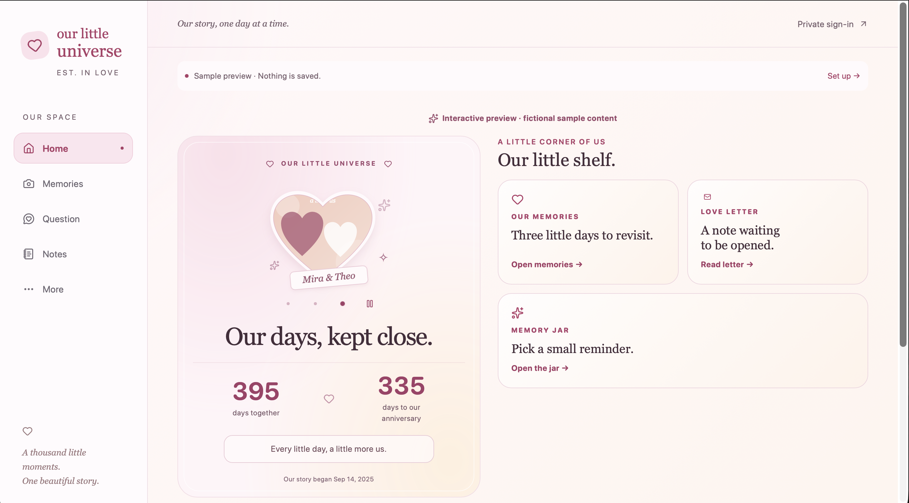

# Our Little Universe

A private couple app, built incrementally as a learning project.

## Preview

[**Explore the live demo →**](https://ours.htetkooo.dev/demo)



Run the app and open `/demo` to explore the interactive fictional preview. It uses sample content only and never reads or saves private couple data.

## Design approach

Our Little Universe is a mobile-first, responsive web app. The primary experience is designed for two people using their phones, while tablet and desktop layouts provide more space for shared memories and navigation.

**Current build:** a private, authenticated shared space for two people. It includes shared Home customization, heart-photo delivery, memories with media, daily questions with private answers and history, Love Letters, Little Jar notes, partner presence, and an expiring partner-invite flow. `/demo` remains fictional and separate from private data. Production operations such as backup/restore workflows and broader end-to-end deployment hardening remain future work.

## Run locally

Use Node.js 22.13+ (tested on Node 24) and pnpm 10.26.2.

```sh
pnpm install --frozen-lockfile
pnpm run dev
```

Open http://localhost:3000/demo. No credentials are needed for the fictional preview. It never writes to localStorage, a database, or Cloudinary. `/space` redirects to login when the app is unconfigured. Do not enter real private content into the demo.

```sh
pnpm run typecheck
pnpm run lint
pnpm test
pnpm run build
```

## Read the project in this order

1. `src/app/layout.tsx` — common HTML shell and metadata.
2. `src/app/demo/[[...section]]/page.tsx` — Next.js routes to all seven preview screens.
3. `src/components/shell.tsx` — navigation and responsive layout.
4. `src/components/preview.tsx` — sample UI interactions; separate from private storage.
5. `src/lib/db/schema.ts` — Drizzle tables, foreign keys and indexes.
6. `src/lib/auth.ts` — Better Auth with Drizzle and closed public registration.
7. `src/lib/authorization.ts` — session-to-couple authorization boundary.
8. `src/lib/memories.ts` — SQL-shaped queries with couple filtering.

Read [the architecture](docs/ARCHITECTURE.md), [Step 1 walkthrough](docs/STEP-1.md), and [security and next steps](docs/SECURITY.md).

## Environment setup

Copy `.env.example` to `.env.local`. Keep real values out of Git and chat. `DATABASE_URL` is a Neon PostgreSQL connection string. `BETTER_AUTH_SECRET` must contain at least 32 cryptographically random characters; `BETTER_AUTH_URL` is the exact app origin. Cloudinary settings stay server-side and are not needed for Step 1.

Password reset and email verification use Resend. In production, verify a dedicated sending subdomain such as `notify.yourdomain.com` in Resend, add its SPF and DKIM DNS records, then set `RESEND_API_KEY` and `EMAIL_FROM="Our Little Universe <hello@notify.yourdomain.com>"`. Set `BETTER_AUTH_URL` to the public app URL, such as `https://app.yourdomain.com`. Every new partner account must confirm its email before it can sign in.

The optional 11:30 unanswered-question reminder uses a small Cloudflare Worker as a scheduler while Vercel continues to host the app, database logic, and Resend integration. See [the Worker setup](workers/question-reminder/README.md). It sends one privacy-safe reminder only to verified members who have not answered yesterday's question.

```sh
pnpm run db:generate
# Review generated SQL before applying to your development Neon branch.
pnpm run db:migrate
```

The included migration has been applied to this checkout’s configured Neon database. Fresh databases still need `pnpm run db:migrate`. Do not run migrations against production as part of casual UI testing. Public signup is deliberately disabled; run `pnpm setup:owner` locally to create the first account and couple membership. Follow [Step 2](docs/STEP-2.md) for the prompts and login check. There is no signup bypass hidden in the demo.

See [Step 3 walkthrough](docs/STEP-3.md) for the memory flow and verification limits.

## Current capabilities

- [x] Closed registration, sign-in, email verification, password reset, owner setup, and couple-scoped authorization.
- [x] Responsive shared Home with customizable widgets, heart-photo carousel, anniversary calculations, and partner presence.
- [x] Private memories, milestones, media attachments, gallery, editing, deletion, and pagination.
- [x] Daily questions with private answers, reveal-after-both-answering, history, reminder support, and a pause flow.
- [x] Persistent Love Letters and Little Jar notes, including read/open tracking.
- [x] Expiring, single-use partner invite creation and acceptance.
- [ ] Backup/restore procedures, broader live end-to-end checks, and operational deployment hardening.

## Stack

Next.js App Router + React + TypeScript; Tailwind CSS; Better Auth; Drizzle ORM; Neon PostgreSQL; Cloudinary SDK. Exact installed versions are recorded in `pnpm-lock.yaml`.

References: [Next.js installation](https://nextjs.org/docs/app/getting-started/installation), [Better Auth Drizzle adapter](https://better-auth.com/docs/adapters/drizzle), [Drizzle Neon guide](https://orm.drizzle.team/docs/connect-neon), [Cloudinary access control](https://cloudinary.com/documentation/control_access_to_media).

### Restricted macOS development environments

If the development watcher reports `EMFILE`, run `WATCHPACK_POLLING=true pnpm run dev`. The preview in this session was checked with polling enabled. This avoids changing system-wide file limits.

### Shared photo duplicate detection

Before deploying the Gallery update, run `pnpm db:migrate` against the intended
application database to apply `0015_media_deduplication.sql`. It adds a nullable
SHA-256 hash and a unique constraint per couple; it does not delete existing photos.

Gallery, memory attachments, and main-card uploads reuse the same library asset
when the original uploaded bytes match. The browser checks before sending the file;
the server computes the fingerprint independently. A deterministic, couple-scoped
Cloudinary public ID with overwrite disabled and the database unique constraint
prevent simultaneous uploads from creating separate copies. Existing rate limits
still apply, so a simultaneous request can ask the user to retry.

Older photos have no source-file hash because previous uploads resized the source.
They remain available, but this feature cannot identify their original bytes
retroactively. Renamed identical files match; edited or recompressed files do not.
If the provider upload succeeds but the database write fails, retry the same file:
the provider object is retained for reuse rather than deleting a file another
request may already reference.

### Direct photo uploads

Apply `0016_direct_media_uploads.sql` with `pnpm db:migrate` **before** deploying
this update. It adds the private upload-intent ledger. Existing photo records and
Cloudinary credentials remain valid; no unsigned upload preset or public bucket
is needed.

Gallery, Memory, and main-card photo uploads now request a signed permission,
POST the file directly from the browser to Cloudinary, then send only an intent
ID to the app to finalize it. Supported files are JPG, PNG and WebP, up to 8 MiB
and 40 megapixels. The new flow preserves original bytes and generates a separate
1280px JPEG preview and a 320px thumbnail for display. Original downloads go directly to Cloudinary;
legacy, resized photos remain available at their existing quality.

Finalization looks up the authenticated provider asset independently, checks
size, dimensions and MIME, downloads the source server-to-server and verifies
SHA-256 before inserting a library row. Verification consumes provider download
bandwidth once per new photo; it does not send file bytes through a browser-to-
Vercel upload request. Browser-provided URLs and metadata are never trusted.
Upload permissions are rate limited (three-second spacing and 120 intents per
couple per hour); app finalization expires after 15 minutes. Cloudinary enforces
its own signed-request lifetime separately.

Retries reuse the same couple-scoped original object and library hash. The
`media:cleanup` command removes old intents for files already in the library.
Abandoned originals/intents are retained for investigation, rather than deleting
an object that could be used by an overlapping retry. Review abandoned uploads
in maintenance if storage usage grows unexpectedly.

After deployment, test a supported photo between 4.5 MB and 8 MiB from Memory and
Gallery, download it and compare its checksum with the source, re-upload it from
the other entry point, and verify that a different couple cannot access it.

Memory photos support **Set as cover** in the create/edit form; save the memory to use that photo on its card, album and Home preview. Open a memory and tap **Show on Home** to feature it for both partners. The selected memory shows **Shown on Home** and **Use automatic selection**. Automatic selection uses the latest milestone, falling back to the latest memory. Deleted selections also fall back automatically. These choices reuse existing photo positions and Home settings, so they need no additional migration.

Gallery has Photos, Albums, and Favorites views. Open a photo and use the heart to add or remove it from the couple’s shared Favorites. Before deploying this update, run `pnpm db:migrate` to apply migration 0017, which adds the favorite flag. Each memory with photos automatically becomes an album, using its first photo as the cover. Albums show the memory date and photo count; opening one loads its attached photos in order. Edit the memory to manage its album. Removing a memory does not remove its photos from the shared library. Albums reuse existing attachments without duplicating files.

Gallery and photo pickers load low-quality 320px thumbnails; opening a photo loads
only its 1280px preview. Original downloads are unchanged. Image responses use
private browser caching with revalidation: each request rechecks membership before
returning 304, avoiding another provider download when the cached image is current.
Old photos generate the requested fixed derivative on first use; later requests
reuse it. Thumbnail dimensions cap resolution; actual KB varies by image content.
